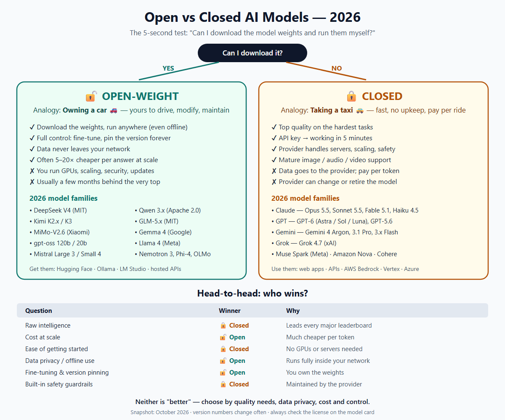

# Open Source vs Closed Source AI Models 

1. What is an AI Model?
An AI model is a trained system that learns patterns from large amounts of data and can then perform tasks such as:
- Answering questions
- Generating text
- Writing code
- Summarizing documents
- Generating images
- Translating languages
- Analyzing data
For example:
You ask: “Write Selenium Java code to test a login page.”

The AI model processes your request and generates the code based on patterns it learned during training.
The important question is:
Who can access, inspect, modify, and run that model?
That's where Open Source and Closed Source models differ.

2. # Open-Source Model
An open-source AI model is a model where the developers make important parts of the model available publicly, usually including the model weights and often the source code, training/configuration information, or documentation.
A better technical term for some AI models is open-weight, because not every model marketed as "open source" satisfies the strict definition of open source.
Simple example
Imagine a company publishes an AI model:
MyAI Model
   |
   ├── Model weights       → Public
   ├── Source code         → Public
   ├── Architecture        → Public
   ├── Documentation       → Public
   └── License             → Public

You can potentially:
- Download it
- Run it locally
- Inspect it
- Fine-tune it
- Integrate it into your application
- Host it on your own servers
depending on the model's license.
Examples
Some well-known open/open-weight model families include:
- Llama
- Mistral
- Qwen
- Gemma
- DeepSeek
However, their licenses and degree of openness differ, so you should always check the specific model's license.

3. # Closed-Source Model
A closed-source AI model is controlled by the company that develops it.
The model's internal implementation and/or weights are generally not publicly released.
For example:
Company's AI Model
       |
       ├── Model architecture → Private
       ├── Model weights      → Private
       ├── Training data      → Mostly private
       ├── Infrastructure    → Private
       └── API               → Public

You generally interact with the model through:
- Web application
- API
- SDK
- Enterprise platform
You don't receive the underlying model weights.
Examples include proprietary models such as:
- OpenAI's GPT models
- Anthropic's Claude models
- Google's proprietary Gemini models
The exact degree of disclosure varies by provider and model.
4. Very Simple Difference
Think of it like a restaurant.
Open-source model 🍳
The restaurant gives you the recipe and ingredients/instructions.
You can potentially:
Take the recipe → modify it → cook it yourself → improve it.

Closed-source model 🍽️
The restaurant gives you the finished food.
You can eat it, but you don't get the recipe.
That's roughly the difference.
5. Major Differences

| # | Feature | 🔓 Open / Open-weight Model | 🔒 Closed-source Model |
|---|---|---|---|
| 1 | Simple analogy | Owning a car 🚗 — yours to drive, modify and maintain | Taking a taxi 🚕 — fast and easy, pay per ride |
| 2 | Model weights | Usually available to download | Private — never shared |
| 3 | Source code | Often available, depending on license | Generally private |
| 4 | Training data | Sometimes published (fully open models like OLMo) | Mostly private |
| 5 | How you use it | Download and run it yourself, or use a hosted API | Web app, API or SDK only |
| 6 | Run locally / offline | Often possible (laptop, on-premise server, private cloud) | Usually not |
| 7 | Setup effort | Higher — GPUs, serving software, configuration | Very low — API key and go |
| 8 | Fine-tuning | Usually possible (full control) | Often limited to provider-supported methods |
| 9 | Customization | High | Lower |
| 10 | Infrastructure | Your responsibility | Provider's responsibility |
| 11 | Cost model | GPU, server and electricity costs; can be cheaper at scale | Pay per token / subscription |
| 12 | Data control & privacy | Very high when self-hosted — data stays in your network | Data goes to the provider; depends on their terms |
| 13 | Transparency | Generally higher — weights can be inspected | Generally lower — black box |
| 14 | Security control | More control if self-hosted (but you must secure it) | Provider controls infrastructure |
| 15 | Built-in safety guardrails | Varies — often need to add your own | Strong, built in and maintained |
| 16 | Raw performance (2026) | Close to the top, usually a few months behind | Leads the hardest benchmarks |
| 17 | Maintenance | Your responsibility | Provider's responsibility |
| 18 | Updates / version | You control them — pin a version forever | Provider controls them — models may change or retire |
| 19 | Vendor dependency | Low | High (pricing, availability, API changes) |
| 20 | Skills needed | Python, Docker, Linux, GPUs, MLOps | Basic API / programming knowledge |
| 21 | License | Varies (MIT, Apache 2.0, Llama license…) — always check | Provider's terms of service |
| 22 | QA testing focus | GPU load, latency, your own guardrails, pinned-version regression | Version drift, rate limits, outages, token cost |
| 23 | Best for | Sensitive data, offline use, fine-tuning, high-volume cost control | Fast start, best quality, minimal maintenance |
| 24 | 2026 examples | DeepSeek V4, Qwen 3.x, Kimi, GLM-5.x, Gemma 4, gpt-oss, Llama 4, Mistral | Claude, GPT, Gemini, Grok |


6. How an Open Model Works
Suppose you download an AI model.
                Open Model
                    |
                    ↓
          Download model weights
                    |
                    ↓
             Your Server
                    |
        ┌───────────┴───────────┐
        ↓                       ↓
     Application             Database
        |
        ↓
      Users

For example, your company could have:
Internal QA Application
        ↓
Internal AI Model
        ↓
Test Cases
        ↓
Test Reports
        ↓
Jira

The model can potentially operate entirely inside your company's infrastructure.
This can be useful when dealing with confidential information.
7. How a Closed Model Works
With a closed model, you normally send a request to the provider's API.
Your Application
       |
       ↓
   API Request
       |
       ↓
AI Provider Infrastructure
       |
       ↓
Closed AI Model
       |
       ↓
Response
       |
       ↓
Your Application

For example:
Your Java Application
       |
       | HTTPS
       ↓
     AI API
       |
       ↓
  Proprietary Model
       |
       ↓
Generated Test Case

You don't need to maintain GPUs, model files, inference servers, etc.
8. Open Source — Advantages
1. More control
You can control:
- Model version
- Infrastructure
- Deployment
- Configuration
- Fine-tuning
For example:
Model v1
Model v2
Model v3

You can decide which version your application uses.
2. Local deployment
You can potentially run the model on:
- Laptop
- On-premise server
- Private cloud
- AWS
- Azure
- GCP
depending on its hardware requirements and license.
3. Data privacy
Suppose your company has:
Patient Information
Employee Information
Financial Data
Internal Source Code

A self-hosted model can keep that information within your controlled environment.
But remember:
Open source does not automatically mean secure or private.
Your deployment must still be properly secured.
4. Customization
You can fine-tune a model for a specific purpose.
For example:
General AI Model
       ↓
Fine-tuning
       ↓
QA Testing Model
       ↓
Specialized knowledge:
   Selenium
   Appium
   Jira
   Xray
   TestNG

The resulting model may perform better for your organization's particular tasks.
5. No dependency on a single API provider
You aren't necessarily dependent on:
Provider API
     ↓
Provider pricing
     ↓
Provider availability

You can host the model yourself.
9. Open Source — Disadvantages
Open models aren't automatically better.
1. Infrastructure cost
Large models can require expensive GPUs.
For example:
Model
 ↓
GPU
 ↓
GPU Memory
 ↓
Server
 ↓
Electricity
 ↓
Maintenance

Running a large model yourself can be expensive.
2. Maintenance
You need to manage:
- Model deployment
- Scaling
- Monitoring
- Security
- GPU infrastructure
- Updates
- Backups
- Performance
With a hosted proprietary model, much of this is handled by the provider.
3. Technical expertise
You may need knowledge of:
- Python
- Docker
- Linux
- GPUs
- CUDA
- Model serving
- APIs
- MLOps
10. Closed Source — Advantages
1. Easy to use
Usually:
Create API Key
      ↓
Call API
      ↓
Get Response

You don't need to download a multi-GB model.
2. High-end infrastructure
The provider handles:
- GPUs
- Servers
- Scaling
- Model deployment
- Infrastructure
- Reliability
3. Usually strong general-purpose performance
Commercial providers can invest heavily in:
- Research
- Training
- Infrastructure
- Evaluation
- Safety
- Optimization
This can make proprietary models highly capable.
4. Continuous improvements
The provider can release:
Model A
   ↓
Model B
   ↓
Model C

without requiring you to manage the underlying infrastructure.
11. Closed Source — Disadvantages
1. Less control
You generally cannot modify the underlying model.
You can't simply say:
"I want to change the model's internal architecture."

2. Vendor dependency
Your application might depend on:
Provider
   ↓
API
   ↓
Pricing
   ↓
Availability

If pricing or API behavior changes, your application may need changes.
3. Limited transparency
You generally don't have complete visibility into:
- Training data
- Model weights
- Internal architecture
- Training process
4. Data governance considerations
If your application sends information to an external provider, your organization needs to evaluate:
- Data retention
- Privacy
- Compliance
- Encryption
- Access controls
- Data residency
- Contractual terms
12. Open vs Closed Architecture
Here's a practical comparison.
Open Model
                 Your Company
                      |
        ┌─────────────┴─────────────┐
        ↓                           ↓
     Backend                    AI Model
                                    |
                                Your GPU
                                    |
                                Your Data

You control most of the stack.
Closed Model
Your Company
     |
     ↓
Your Application
     |
     ↓
API
     |
     ↓
AI Provider
     |
     ↓
Proprietary Model

The provider controls the model infrastructure.
13. Important Point: Open Source ≠ Free
This is a very common misunderstanding.
Open-source doesn't necessarily mean free.
There can be:
Model license
      +
GPU cost
      +
Cloud cost
      +
Storage
      +
Engineering
      +
Maintenance

For example, you may download a model at no licensing cost but spend significant money running it.
14. Important Point: Closed Source ≠ Bad
Closed-source models can be extremely useful.
For example, a startup might not want to build:
GPU infrastructure
+
ML team
+
Model serving
+
Monitoring
+
Scaling

Instead:
Application
    ↓
AI API
    ↓
Response

This allows the startup to focus on its actual product.
15. Example From QA Testing
Since you're working with QA and automation, imagine you want to build an AI-powered test-case generator.
Option A — Open Model
Jira Requirement
       ↓
Open AI Model
       ↓
Test Case Generator
       ↓
Test Cases
       ↓
Xray

You could potentially host the model inside your organization's environment.
Advantages:
- Customization
- Internal data control
- Fine-tuning
- Integration flexibility
Option B — Closed Model
Jira Requirement
       ↓
Your QA Tool
       ↓
AI API
       ↓
Closed Model
       ↓
Generated Test Cases
       ↓
Xray

Advantages:
- Faster implementation
- No model infrastructure
- Less ML expertise required
- Provider manages scaling
16. Another QA Example
Suppose you give an AI this requirement:
"User should be locked after three incorrect password attempts."

AI could generate:
TC01 – Login with valid credentials
TC02 – Login with invalid password once
TC03 – Login with invalid password twice
TC04 – Login with invalid password three times
TC05 – Verify account is locked
TC06 – Verify appropriate error message
TC07 – Verify login after account unlock
TC08 – Verify admin can unlock account

Both open and closed models can potentially perform this task.
The difference is where the model runs and how much control you have over it.
17. Open Model vs Closed Model — Decision
Choose Open/Open-weight when:
You need:
- Maximum control
- Self-hosting
- Data isolation
- Customization
- Fine-tuning
- Offline/private deployment
- Control over model version
Example:
Enterprise
     ↓
Sensitive internal data
     ↓
Private AI infrastructure
     ↓
Open model

Choose Closed when:
You need:
- Fast implementation
- High-quality general reasoning
- Minimal infrastructure management
- Managed APIs
- Easy scaling
- Strong provider support
Example:
Startup
   ↓
AI-powered product
   ↓
API
   ↓
Commercial AI model

18. The Most Important Concept
Don't think of the difference simply as:
Open = Good
Closed = Bad

or:
Open = Free
Closed = Paid

That's incorrect.
Think of it as:
Open/Open-weight → More control and customization

versus
Closed → More convenience and managed infrastructure

19. One-line Interview Answer
If an interviewer asks:
"What is the difference between open-source and closed-source AI models?"
You can answer:
Open-source or open-weight AI models provide public access to the model weights and/or source components under a license that allows varying degrees of use, modification, and deployment, giving organizations greater control and customization. Closed-source models keep their underlying model and implementation proprietary and are typically accessed through APIs or hosted applications, providing greater convenience but less control over the underlying technology.

Simple memory trick
OPEN
 ↓
More Control
More Customization
Self Hosting
More Responsibility

CLOSED
 ↓
More Convenience
Managed Infrastructure
Less Control
Vendor Dependency

---

# SimpleWay — Open vs Closed Models for Absolute Beginners

> Every idea below is explained in **plain words** first, then with an **everyday analogy**, and only then with a little **technical detail**. No AI background needed.


*(Scalable version: [Open_vs_Closed_Models_2026.svg](Open_vs_Closed_Models_2026.svg))*

## 20. What is an "open" model? (Open-source / Open-weight)

- **In plain words:** The company that built the AI lets anyone **download the AI itself** and run it on their own computer or servers.
- **Everyday analogy:** Buying a **car**. It's yours — keep it in your garage, drive it anywhere, repaint it, or change the engine. But you pay for fuel, insurance and repairs yourself.
- **A bit more technical:**
  - What you download is the **weights** — the billions of learned numbers that *are* the model (see the Weights/Parameter entries in the AI Glossary).
  - **Open-weight** = weights are public, but the training data and training code may stay secret. Most "open-source" AI models are really open-weight.
  - **Truly open-source** = weights + training code + training data recipe are all public (rare — e.g. AI2's OLMo).
  - Every open model has a **license** that says what you may do with it. Apache 2.0 and MIT are very permissive; some, like the Llama license, add conditions.

## 21. What is a "closed" model? (Closed-source / Proprietary)

- **In plain words:** The company keeps the AI on **its own servers**. You can use it through a website, an app or an API, but you never get the model file.
- **Everyday analogy:** Taking a **taxi or Uber**. You get where you're going quickly and the driver handles fuel and repairs — but you can't take the car home or modify it, and you pay per ride.
- **A bit more technical:**
  - You send a request (prompt) over HTTPS with an **API key** and get a response back.
  - You pay **per token** (e.g. "$2 per million input tokens").
  - The provider decides when the model is updated or retired.

## 22. The 5-second test — "Can I download it?"

```
Can I download the model weights and run them myself?
            │
     ┌──────┴──────┐
    YES            NO
     │              │
  OPEN-WEIGHT     CLOSED
  (own the car)   (take the taxi)
```

**Common confusion:** The *company* doesn't decide the category — the *specific model* does. One company can release both:

| Company | Closed model (API only) | Open model (downloadable) |
|---|---|---|
| OpenAI | GPT-5.x / GPT-6 | gpt-oss-120b, gpt-oss-20b |
| Google | Gemini | Gemma |
| Mistral AI | Mistral Medium (API) | Mistral Large 3, Mistral Small 4 |
| Alibaba | Qwen "Max" (API) | Most Qwen3.x models |
| Meta | Muse Spark (newer, API) | Llama 4 Scout / Maverick |

## 23. Inventory — Models available in 2026

> **Snapshot date: October 2026.** AI models are released every few weeks, so version numbers go out of date quickly. Treat the **family names** as the stable part and check the provider's website for the latest version before using one.

### 23a. Closed (proprietary) models — use through an app or API

| Provider | Model family (latest notable versions) | Known for | Where you use it |
|---|---|---|---|
| **Anthropic** | **Claude** — Opus 5.5, Sonnet 5.5, Fable 5.1, Haiku 4.5 | Coding, long agentic tasks, writing, safety | claude.ai, Claude Code, API, AWS Bedrock, Google Vertex |
| **OpenAI** | **GPT** — GPT-6 (Astra / Sol / Luna), GPT-5.6 | General assistant (ChatGPT), reasoning, images | ChatGPT, API, Azure OpenAI |
| **Google** | **Gemini** — Gemini 4 Argon (announced Sep 30 2026), Gemini 3.1 Pro, Gemini 3.x Flash | Multimodal (text, image, video, audio), very long context | Gemini app, Google AI Studio, Vertex AI |
| **xAI** | **Grok** — Grok 4.7 | Real-time info from X, coding | Grok app, X, API |
| **Meta** | **Muse Spark** | Meta's newer flagship, offered through a paid API | Meta AI, API |
| Others | Amazon Nova, Cohere Command, Mistral's API-only models | Enterprise and cloud-specific uses | AWS, Cohere, Mistral platforms |

### 23b. Open-weight models — download and run yourself

| Provider (country) | Model family (latest notable versions) | Typical license | Known for |
|---|---|---|---|
| **DeepSeek** (China) | **DeepSeek V4** — V4-Pro, V4-Flash; R1 (reasoning) | MIT | Strong reasoning and coding at low cost |
| **Alibaba** (China) | **Qwen 3.x** — Qwen3.5 / 3.6 / 3.8, Qwen3-Coder; sizes from 4B to 235B+ | Apache 2.0 (most sizes) | Best all-rounder, many sizes, multilingual |
| **Moonshot AI** (China) | **Kimi** — K2.6, K2.7 Code, K3 | Modified MIT | Agentic coding, tool use, UI-to-code |
| **Z.ai / Zhipu** (China) | **GLM-5.x** — GLM-5.2, GLM-5.3 | MIT | Coding agents, 1M-token context |
| **Xiaomi** (China) | **MiMo** — MiMo-V2.6-Pro / Flash | MIT | Top open-model scores in Sep–Oct 2026 |
| **MiniMax** (China) | **MiniMax M3** | Permissive (check model card) | Long context, agents |
| **Google** (USA) | **Gemma 4** — 12B, 31B and smaller | Gemma terms (check) | Runs on laptops/phones, high quality for its size |
| **OpenAI** (USA) | **gpt-oss** — 120b, 20b | Apache 2.0 | Reasoning and tool use, private deployment |
| **Meta** (USA) | **Llama 4** — Scout (10M-token context), Maverick | Llama Community License (has conditions) | Huge ecosystem of fine-tunes and tutorials |
| **Mistral AI** (France) | **Mistral Large 3**, **Mistral Small 4**, Devstral (coding) | Apache 2.0 | European option, on-premise enterprise |
| **NVIDIA** (USA) | **Nemotron 3** — Nano, Super, Ultra | NVIDIA Open Model License | Optimised for NVIDIA GPUs, enterprise |
| **Microsoft** (USA) | **Phi-4**, Phi-4-mini | MIT | Small models for edge devices |
| **AI2** (USA) | **OLMo** | Apache 2.0 | *Fully* open: data + code + weights |

**Where to find open models:** [Hugging Face](https://huggingface.co) (download), **Ollama** / **LM Studio** (run on your laptop with one command), or hosted APIs such as Together, Fireworks, Groq, OpenRouter, AWS Bedrock (use an open model without owning GPUs).

## 24. Head-to-head comparison

### 24a. Open vs Closed — the overall picture (2026)

| Question | Closed models (Claude, GPT, Gemini, Grok) | Open-weight models (DeepSeek, Qwen, Kimi, GLM, Gemma, Llama…) | Who wins? |
|---|---|---|---|
| **Raw intelligence (hardest tasks)** | Top of every leaderboard | Usually a few months behind the very best closed models, and the gap keeps shrinking | 🔒 Closed |
| **Cost per answer** | Pay per token, e.g. ~$2–$10 per million input tokens for flagships | Hosted open models are often 5–20× cheaper. Self-hosting has GPU costs instead | 🔓 Open |
| **Getting started** | API key → working in 5 minutes | Download, GPU setup, serving software (or use a host) | 🔒 Closed |
| **Data privacy** | Data goes to the provider (enterprise contracts can limit retention) | Can run 100% inside your network, even offline | 🔓 Open |
| **Customisation / fine-tuning** | Limited to what the provider allows | Full control — fine-tune, quantise, modify | 🔓 Open |
| **Version stability** | Provider may change or retire a model | You keep the exact version forever | 🔓 Open |
| **Maintenance effort** | Provider handles everything | You handle servers, scaling, security, updates | 🔒 Closed |
| **Safety guardrails out of the box** | Strong, built in and maintained | Varies by model — you often add your own | 🔒 Closed |
| **Transparency** | Black box | Weights can be inspected; some publish data too | 🔓 Open |
| **Multimodal (image, audio, video)** | Very mature | Improving (Qwen, Gemma, Llama 4, Kimi) | 🔒 Closed |

### 24b. Matched pairs — closed flagship vs nearest open alternative

| If you'd use this closed model… | …the nearest open alternative is | Trade-off |
|---|---|---|
| Claude Opus 5.5 / Sonnet 5.5 (coding, agents) | Kimi K2.x / K3, GLM-5.x, DeepSeek V4-Pro | Open is cheaper; Claude is more reliable on long, multi-step coding tasks |
| GPT-6 / GPT-5.6 (general assistant) | Qwen 3.x, DeepSeek V4, gpt-oss-120b | Open is close on everyday chat; GPT leads on the hardest reasoning |
| Gemini (multimodal, long documents) | Llama 4 Scout (10M context), Qwen-VL, Gemma 4 | Gemini handles video/audio better; open models can run locally |
| Claude Haiku / Gemini Flash (fast, cheap) | Gemma 4, Qwen3.x small sizes, Phi-4, gpt-oss-20b | Small open models run on a laptop for free |

### 24c. QA-tester view — which to choose for a test-automation project?

| Your situation | Recommended | Why |
|---|---|---|
| Learning, prototyping, generating test cases quickly | **Closed** (e.g. Claude, GPT, Gemini) | Best quality, zero setup |
| Company forbids sending code or requirements outside the network | **Open-weight, self-hosted** (e.g. Qwen, Gemma, gpt-oss via Ollama) | Data never leaves your servers |
| Running thousands of AI evals in CI every day | **Open** via a cheap host, or a small closed model | Cost per run matters |
| Fine-tuning on your own Jira/Xray history | **Open-weight** | Full fine-tuning access |
| Need repeatable results across months (regression testing) | **Open-weight, pinned version** | The model never changes under you |

**QA testing tip — what to test differently:**

| Test area | Closed model | Open model |
|---|---|---|
| Version drift | Re-run evals whenever the provider updates the model | Version is pinned — re-test only when *you* upgrade |
| Rate limits / outages | Test retry, back-off and fallback when the API is down | Test GPU memory, load and latency on your own server |
| Safety / Prompt injection | Built-in guardrails exist, but still test | Usually need your own guardrails — test them heavily |
| Cost | Track token usage per test run | Track GPU hours and server cost |

## 25. One-minute recap

```
OPEN-WEIGHT  = Own the car 🚗
  • Download the model weights
  • Run anywhere, even offline
  • Full control, cheaper at scale
  • YOU maintain it
  • 2026 leaders: DeepSeek V4, Qwen 3.x, Kimi, GLM-5, MiMo, Gemma 4, gpt-oss, Llama 4, Mistral

CLOSED       = Take the taxi 🚕
  • Use through an app / API only
  • Best raw quality, zero setup
  • Pay per token, provider controls updates
  • PROVIDER maintains it
  • 2026 leaders: Claude (Anthropic), GPT (OpenAI), Gemini (Google), Grok (xAI)

Neither is "better" — pick based on quality needs, data privacy, cost, and control.
```

*Sources for the 2026 inventory (checked October 2026): provider websites and model cards on Hugging Face, plus public leaderboards and roundups (Artificial Analysis, LMArena, felloai.com "Best AI Models October 2026", browsewiz.com "Frontier AI Models Sep 2026", benchlm.ai open-source leaderboard, Fireworks AI "Best Open Source LLMs 2026"). Always confirm the license on the model card before using a model commercially.*